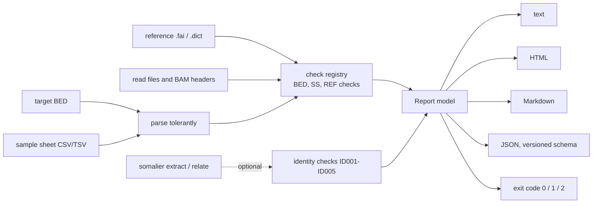

# ngs-preflight

Before your first run, check your sequencing inputs (target BED, sample sheet, reference sequence, and optional sample identity). Get a plain-language explanation of any issues.

[](.github/workflows/ci.yml)
[](LICENSE)
[](pyproject.toml)
[](.github/workflows/ci.yml)

Documentation, the check catalogue, and example reports are available at **<https://ericwootton.github.io/ngs-preflight/>**.

## Report at a glance

HTML report for the intentionally flawed [`examples/messy`](examples/messy) submission. The full report is
available at [`examples/reports/messy.html`](examples/reports/messy.html). Results from the same run are
also available in [Markdown](examples/reports/messy.md) and [JSON](examples/reports/messy.json) formats:


The good example at [`examples/good`](examples/good) ends "Ready to run".

## Why this exists

Most failed sequencing analyses result from subtle problems in the inputs. For example, a contig labelled `chr1` in the reference sequence is labelled `1` in the BED file. Other examples include files listed in the sample sheet which no one has uploaded, or two samples from the same person. Each problem costs hours of computation or a round of emails before anyone notices. `ngs-preflight` detects these problems in seconds and explains what is wrong and how to correct it. This explanation uses language which allows the laboratory or customer to take specific action.

## Quickstart

```bash
pipx install .                                    # or: python -m pip install .
preflight check --samplesheet examples/good/samples.csv --bed examples/good/targets.bed \
    --reference examples/reference/GRCh38_no_alt_analysis_set.fa.fai --reads-dir examples/good/reads
preflight check --samplesheet examples/messy/samples.csv --bed examples/messy/targets.bed \
    --reference examples/reference/GRCh38_no_alt_analysis_set.fa.fai --reads-dir examples/messy/reads \
    --format html --out messy.html                # exit code 1: it has errors
preflight explain BED003                          # what a check means and how to fix it
```

Docker (no Python needed):

```bash
docker build -t ngs-preflight:0.1.0 .
docker run --rm --user "$(id -u):$(id -g)" -v "$PWD:/data" ngs-preflight:0.1.0 preflight check --bed targets.bed --reference GRCh38.fa.fai
```

Exit codes mean `0` pass, `1` errors (or warnings with `--strict` ), `2` warnings only, and `3` tool or usage error.

### Other commands

```bash
preflight fix-bed targets.bed --add-chr --sort    # writes targets.fixed.bed; never edits in place
preflight docs                                    # regenerate docs/checks.md and docs/report.schema.json
```

### Optional: sample identity checks

When [somalier](https://github.com/brentp/somalier) (not bundled) is used, the tool also checks sample identity against the sample sheet. This includes checking for duplicates, parent-child relatedness, and unexpected relatives, and comparing declared sex with inferred sex.

```bash
preflight check --samplesheet samples.csv --identity --sites sites.hg38.vcf.gz \
    --fasta GRCh38.fa --alignments-or-vcfs HG002.bam HG003.bam HG004.bam
# somalier in Docker (mount whatever paths you pass):
preflight check ... --somalier-cmd 'docker run --rm -v /data:/data brentp/somalier:v0.3.5 somalier'
```

Pre-extracted `.somalier` files can be used in place of BAM/CRAM/VCF. If somalier is unavailable, the sample identity check is logged as skipped along with the reason, and the tool does not crash.

## What it does



- The registry contains **28 checks**, each of which includes an ID, severity, a plain-language message, technical details, and a suggested fix. The complete list is generated at [`docs/checks.md`](docs/checks.md). `preflight explain <ID>` displays 1 entry.
- Pure Python (pydantic, rich, jinja2, pyyaml). BAM headers are read and gzip integrity is checked without htslib. It can be run on Linux and Windows.
- Reports include a terminal table, single-file HTML (no external resources, readable without colour), Markdown for tickets and JSON for pipelines ([schema and notes](docs/json-report.md)).
- Customers get a one-page guide at [`docs/for-customers.md`](docs/for-customers.md).

## Data and citations

- `examples/reference/GRCh38_no_alt_analysis_set.fa.fai` is the index of the NCBI GRCh38 no-alt analysis set (`GCA_000001405.15`); only the contig list is used.
- The identity fixtures in `tests/data/identity/` are real somalier extracts for the Genome in a Bottle Ashkenazim trio (HG002 son, HG003 father, HG004 mother) at the 17,766 common hg38 sites in somalier's `sites.hg38.vcf.gz`. Autosomal genotypes come from the GIAB v4.2.1 GRCh38 benchmark calls; chrX and chrY genotypes were called from the public Illumina NovaSeq 35x BAMs (`gs://deepvariant/case-study-testdata`), because the benchmark has no chrX. They are not extracted from the BAMs end to end (streaming 46 GB per sample was impractical), and sites missing from a benchmark VCF are taken as hom-ref. How they were made, and the relatedness and sex values somalier reports for them, are in [`docs/identity-fixtures.md`](docs/identity-fixtures.md) (generated from the real output).
- Pedersen BS, Bhetariya PJ, Brown J, et al. Somalier: rapid relatedness estimation for cancer and germline sequencing. *Genome Medicine* 2020;12:62. Zook JM, et al. Extensive sequencing of seven human genomes to characterize benchmark reference materials. *Scientific Data* 2016;3:160025.

## Limitations

- It checks file formats and consistency. It does not verify the clinical or scientific validity of the data.
- BED007 (1-based coordinates) is explicitly described as a heuristic check. It may miss problems and may rarely flag files without problems. The method used by this check is documented in `docs/checks.md`.
- CRAM headers are not read (this is reported as a note, REF003). Only BAM headers are compared with the reference sequence.
- Genome build detection is supported only for human GRCh37 and GRCh38. For other species, sequence names and lengths are checked against the specified reference.
- Gzip integrity is fully validated only for files no larger than 32 MiB. For larger non-BGZF files, only the first 4 MiB is checked. For BGZF files such as BAM, the first 4 MiB and the end-of-file marker are checked. This allows truncation during upload to be detected.
- Sample identity checks require somalier 0.3.5 and its sites file, and are reliable only when whole-genome or exome data are used. If few informative sites are available, ID005 flags this.
- Columns in the sample sheet follow 1 fixed layout ([`schema/samplesheet.yaml`](src/ngs_preflight/schema/samplesheet.yaml)).

## Repository layout

```text
src/ngs_preflight/    the package: checks/, report/, identity/, cli.py, runner.py
tests/                pytest suite; tests/data holds one fixture per failure mode and the somalier trio
examples/             good and messy submissions, and generated reports in examples/reports/
docs/                 the documentation site (mkdocs.yml); checks.md and report.schema.json are generated
scripts/              build_examples.py, check_coverage.py
Dockerfile            python:3.12-slim; runs as root so WDL engines can pass it inputs
CLAUDE.md             conventions for working on this repository
```

## How this was built

The author made the design decisions about which checks to include, message wording, check severity, and thresholds for sample identity. They also reviewed all diffs and validated the results. [Claude Code](https://claude.com/claude-code) did scaffolding, generated tests, and made iterative changes under the author's direction. These diffs also underwent multiple independent AI reviews. Actual tool output is used wherever results are presented (somalier output for public data), and all numerical values in the documentation are generated by code. See [`CLAUDE.md`](CLAUDE.md).

## Licence

MIT, see [`LICENSE`](LICENSE).
