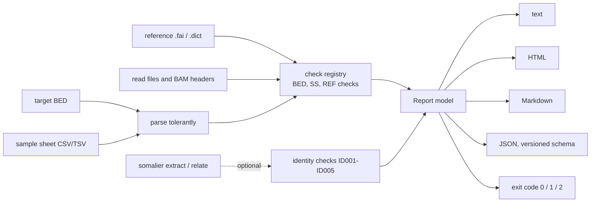

# ngs-preflight

Check the inputs of a sequencing analysis (target BED, sample sheet, reference, and optionally sample identity) before the first run, and get problems explained in plain language.

[](.github/workflows/ci.yml)
[](LICENSE)
[](pyproject.toml)
[](.github/workflows/ci.yml)

## Report at a glance

The HTML report for the deliberately broken [`examples/messy`](examples/messy) submission (the full file is
[`examples/reports/messy.html`](examples/reports/messy.html); the same run is also available as
[Markdown](examples/reports/messy.md) and [JSON](examples/reports/messy.json)):


The "good" example, [`examples/good`](examples/good), ends with "Ready to run".

## Why this exists

Most failed sequencing analyses fail on something small in the inputs: a BED file with `1` where the reference says `chr1`, a sample sheet that lists a file nobody uploaded, two samples that are the same person. Each costs hours of compute or a round of emails before anybody notices. `ngs-preflight` finds these in seconds and says what is wrong and how to fix it, in words a lab or a customer can act on.

## Quickstart

```bash
pipx install .                                    # or: python -m pip install .
preflight check --samplesheet examples/good/samples.csv --bed examples/good/targets.bed \
    --reference examples/reference/GRCh38_no_alt_analysis_set.fa.fai --reads-dir examples/good/reads
preflight check --samplesheet examples/messy/samples.csv --bed examples/messy/targets.bed \
    --reference examples/reference/GRCh38_no_alt_analysis_set.fa.fai --reads-dir examples/messy/reads \
    --format html --out messy.html                # exit code 1: it has errors
preflight explain BED003                          # what a check means and how to fix it
```

Docker (no Python needed):

```bash
docker build -t ngs-preflight:0.1.0 .
docker run --rm -v "$PWD:/data" ngs-preflight:0.1.0 preflight check --bed targets.bed --reference GRCh38.fa.fai
```

Exit codes: `0` pass, `1` errors (or warnings with `--strict`), `2` warnings only, `3` tool or usage error.

### Other commands

```bash
preflight fix-bed targets.bed --add-chr --sort    # writes targets.fixed.bed; never edits in place
preflight docs                                    # regenerate docs/checks.md and docs/report.schema.json
```

### Optional: sample identity checks

With [somalier](https://github.com/brentp/somalier) (not bundled) the tool also checks that samples are who the sheet says they are: duplicates, parent-child relatedness, unexpected relatives, declared versus inferred sex.

```bash
preflight check --samplesheet samples.csv --identity --sites sites.hg38.vcf.gz \
    --fasta GRCh38.fa --alignments-or-vcfs HG002.bam HG003.bam HG004.bam
# somalier in Docker (mount whatever paths you pass):
preflight check ... --somalier-cmd 'docker run --rm -v /data:/data brentp/somalier:v0.3.5 somalier'
```

Pre-extracted `.somalier` files are accepted in place of BAM/CRAM/VCF. If somalier is not available the identity checks are listed as skipped, with the reason; nothing crashes.

## What it does



- **28 checks** in a registry; each has an ID, a severity, a plain-language message, technical detail and a suggested fix. The full list is generated into [`docs/checks.md`](docs/checks.md); `preflight explain <ID>` prints one entry.
- Pure Python (pydantic, rich, jinja2, pyyaml). BAM headers and gzip integrity are read without htslib. Runs on Linux and Windows.
- Reports: terminal table, single-file HTML (no external assets, readable without colour), Markdown for tickets, JSON for pipelines ([schema and notes](docs/json-report.md)).
- Customers get a one-page guide: [`docs/for-customers.md`](docs/for-customers.md).

## Data and citations

- `examples/reference/GRCh38_no_alt_analysis_set.fa.fai` is the index of the NCBI GRCh38 no-alt analysis set (`GCA_000001405.15`); only the contig list is used.
- The identity fixtures in `tests/data/identity/` are somalier extracts of the Genome in a Bottle Ashkenazim trio (HG002 son, HG003 father, HG004 mother), Illumina NovaSeq 35x, aligned to GRCh38, from the public DeepVariant case-study bucket (`gs://deepvariant/case-study-testdata`). They contain genotype summaries at about 17,000 common sites, not reads. Sites list: [`sites.hg38.vcf.gz`](https://github.com/brentp/somalier/files/3412456/sites.hg38.vcf.gz) from somalier. Observed values are in [`docs/identity-fixtures.md`](docs/identity-fixtures.md).
- Pedersen BS, Bhetariya PJ, Brown J, et al. Somalier: rapid relatedness estimation for cancer and germline sequencing. *Genome Medicine* 2020;12:62. Zook JM, et al. Extensive sequencing of seven human genomes to characterize benchmark reference materials. *Scientific Data* 2016;3:160025.

## Limitations

- It checks file format and consistency. It is not a clinical or scientific validation of the data.
- BED007 (1-based coordinates) is a heuristic and says so; it can miss cases and, rarely, flag a file that is fine. How it decides is documented in `docs/checks.md`.
- CRAM headers are not read (reported as a note, REF003). Only BAM headers are compared with the reference.
- Genome build detection knows human GRCh37 and GRCh38 only; other species are checked by name and length against the reference you give.
- Gzip integrity is proven in full only for files up to 32 MiB; larger non-BGZF files get a check of their first 4 MiB only, and BGZF files (such as BAM) get an end-of-file marker check plus their first 4 MiB, which catches truncated uploads.
- Identity checks need somalier 0.3.5 and its sites file, and are reliable only with whole-genome or exome data; with few informative sites ID005 says so.
- Sample-sheet columns follow one fixed layout ([`schema/samplesheet.yaml`](src/ngs_preflight/schema/samplesheet.yaml)).

## Repository layout

```text
src/ngs_preflight/    the package: checks/, report/, identity/, cli.py, runner.py
tests/                pytest suite; tests/data holds one fixture per failure mode and the somalier trio
examples/             good and messy submissions, and generated reports in examples/reports/
docs/                 checks.md and report.schema.json (generated), for-customers.md, json-report.md
scripts/              build_examples.py, check_coverage.py
Dockerfile            python:3.12-slim, non-root
CLAUDE.md             conventions for working on this repository
```

## How this was built

The author made the design decisions (what to check, how each message is worded, the severity of each check, the identity thresholds), reviewed every diff and verified the results. [Claude Code](https://claude.com/claude-code) did scaffolding, test generation and iteration under that direction, and independent AI review passes were run on the diffs. Real tool output (somalier on public data) is used wherever a result is claimed, and every number in the docs is generated by code. See [`CLAUDE.md`](CLAUDE.md).

## Licence

MIT, see [`LICENSE`](LICENSE).
