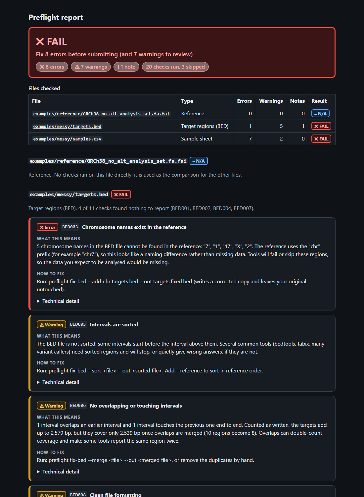

# ngs-preflight

Check the inputs of a sequencing analysis before the first run: the target BED, the sample sheet,
the reference, and optionally whether the samples are who the sheet says they are. Problems are
explained in plain language, with a suggested fix, so a lab or a customer can act on them without
a bioinformatician in the loop.

[Example reports](examples.md){ .md-button .md-button--primary }
[Check catalogue](checks.md){ .md-button }
[Source on GitHub](https://github.com/ericwootton/ngs-preflight){ .md-button }

!!! note "Not a clinical tool"
    It checks file format and consistency between files. It does not validate the science or
    the data quality of a sequencing run.

## Why it exists

Most failed sequencing analyses fail on something small in the inputs: a BED file with `1` where
the reference says `chr1`, a sample sheet that lists a file nobody uploaded, two samples that are
the same person. Each costs hours of compute or a round of emails before anybody notices.
`ngs-preflight` finds these in seconds.

## What it checks

| Group | Checks | Examples |
|---|---|---|
| Target BED | BED001-BED011 | unreadable lines, end before start, `1` versus `chr1`, intervals past the contig end, unsorted or overlapping intervals, 1-based coordinates |
| Sample sheet | SS001-SS009 | missing columns, duplicate or unsafe sample IDs, read files that do not exist or are truncated, R1/R2 pairing, unknown sex values, broken family links |
| Reference | REF001-REF003 | contig naming style and genome build, contigs missing from the reference, read-file headers that do not match |
| Identity (optional) | ID001-ID005 | duplicated samples, parent-child pairs that are not related, unexpected relatives, declared versus inferred sex; needs [somalier](https://github.com/brentp/somalier) |

Every check has an ID, a severity, a plain-language message, technical detail and a suggested
fix. The [catalogue](checks.md) is generated from the code, and `preflight explain <ID>` prints
one entry with a link back to it.

## Install and run

```bash
pipx install git+https://github.com/ericwootton/ngs-preflight     # or: python -m pip install .
preflight check --samplesheet samples.csv --bed targets.bed \
    --reference GRCh38_no_alt_analysis_set.fa.fai --reads-dir reads/ \
    --format html --out preflight.html
preflight explain BED003
```

Or with Docker, without Python:

```bash
docker build -t ngs-preflight:0.1.0 https://github.com/ericwootton/ngs-preflight.git
docker run --rm -v "$PWD:/data" ngs-preflight:0.1.0 \
    preflight check --bed targets.bed --reference GRCh38.fa.fai
```

Exit codes: `0` pass, `1` errors (or warnings with `--strict`), `2` warnings only, `3` tool or
usage error. A pipeline can stop on a non-zero exit before any compute is spent; the
[wgs-release-validation](https://ericwootton.github.io/wgs-release-validation/) workflow does
exactly that.

## What a report looks like

The HTML report for a deliberately broken submission:



Reports come as terminal text, a single self-contained HTML file, Markdown for tickets and JSON
for pipelines ([schema](json-report.md)). [Open the full example reports](examples.md).

## For customers

[How to prepare your BED file and sample sheet](for-customers.md) is a one-page guide that can be
sent to a customer as it is.
